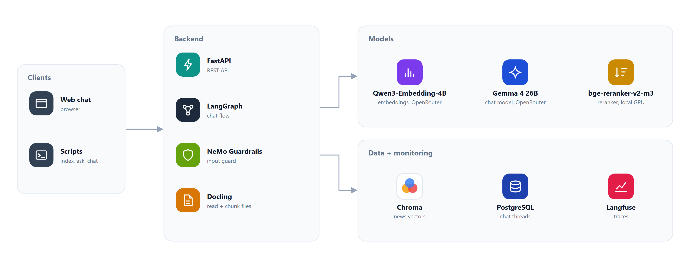
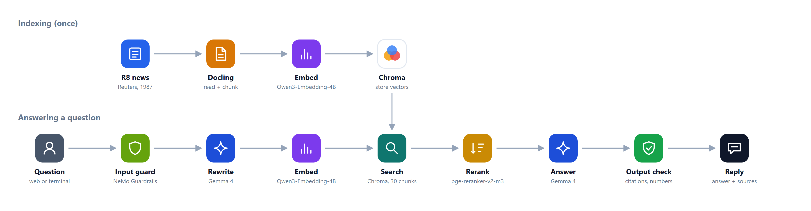

# Financial News Assistant (RAG)

Ask questions about financial news and get short answers with their sources.
The answers come from the Reuters R8 news dataset. It works in English and Arabic.

## Architecture



## How it works



## Models

| Part | Model |
|---|---|
| Embedding | `qwen/qwen3-embedding-4b` |
| Reranker | `qwen/qwen3-reranker-8b` (OpenRouter; or local `BAAI/bge-reranker-v2-m3`) |
| Chat | `google/gemma-4-26b-a4b-it` |

The models are set in `.env`.

## Project Structure

```
news-rag/
├── datasets/          R8 train and test files
├── data/eval/         test questions
├── scripts/           index, ask, chat and evaluate from the terminal
├── src/
│   ├── main.py        FastAPI app
│   ├── controllers/   chunking, search, chat flow
│   ├── models/        data classes and chat history
│   ├── routes/        API endpoints
│   ├── stores/        embedding, Chroma, reranker, guards, prompts
│   └── helpers/       settings
├── ui/                web page
├── tests/
├── Dockerfile
└── docker-compose.yml
```

## Prerequisites

- Python 3.12 and [uv](https://docs.astral.sh/uv/)
- An [OpenRouter](https://openrouter.ai) API key
- PostgreSQL, for saving the chat threads

## How to run

**1. Install**

```bash
uv sync --extra local
```

`local` adds indexing (docling, Chroma) and the local GPU reranker. The API alone needs only `uv sync`.

**2. Configure**

```bash
cp .env.example .env
```

In `.env`, add your OpenRouter key to `CHAT_API_KEY` and your Postgres details to `POSTGRES_*`.

**3. Index the news** (once)

```bash
uv run python -m scripts.index_files datasets
```

If it stops halfway, run it again. It continues where it stopped.

**4. Start the app**

```bash
uv run uvicorn src.main:app
```

Open http://localhost:8000 and ask a question. The first question takes about a minute,
because the reranker loads. After that, answers take a few seconds.

**Or use the terminal** (no Postgres needed):

```bash
uv run python -m scripts.chat
uv run python -m scripts.ask "Why did OPEC cut oil output?"
```

## Deploy to Vercel

Vercel runs the API without Chroma, torch or docling. It searches a read-only copy of the
vectors in `vectors/` (exact cosine search with numpy), and reranks through OpenRouter.

**1. Export the vectors** (after indexing, and again after every re-index), then commit `vectors/`:

```bash
uv run python -m scripts.export_vectors
```

**2. Postgres for the chat threads (optional).** Create a database on Neon, Supabase or Vercel
Postgres and copy its connection string. Without it the chat still works, but threads are kept in
memory and are lost when the function restarts.

**3. Create the Vercel project** from this repository (Vercel finds FastAPI through
`[tool.vercel]` in `pyproject.toml`), and add the variables from `.env.vercel.example`:

| Variable | Value |
|---|---|
| `CHAT_API_KEY` | your OpenRouter key |
| `VECTOR_DB_PROVIDER` | `numpy` |
| `VECTOR_DB_PATH` | `vectors` |
| `POSTGRES_URL` | the connection string, e.g. `postgres://...?sslmode=require` |

`.vercelignore` keeps the datasets, Chroma folder, tests and scripts out of the function.
Indexing (`/ai/v1/nlp/index`) does not work on Vercel; index locally and export again.

## API

| Method | Path | |
|---|---|---|
| `POST` | `/ai/v1/nlp/index` | Index a file or folder |
| `POST` | `/ai/v1/nlp/search` | Search |
| `POST` | `/ai/v1/chat` | Ask a question |
| `GET` | `/ai/v1/threads` | List chat threads |

API docs: http://localhost:8000/docs

## Tests

```bash
uv run pytest
```
